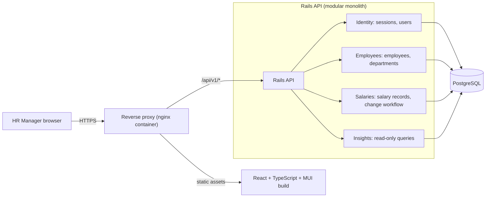
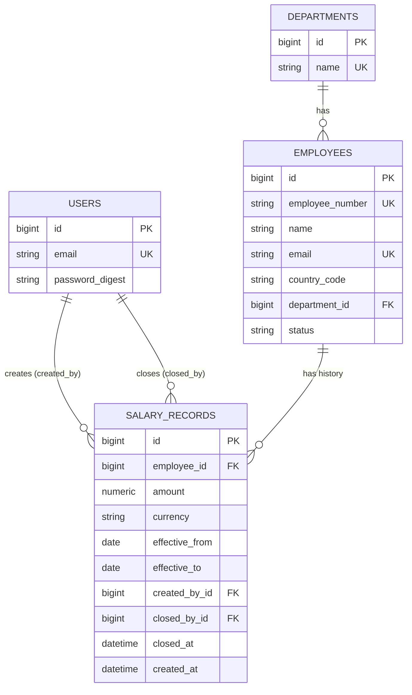

# Salary Management System — Architecture

This document describes the final architecture for the MVP defined in [requirements.md](./requirements.md). If the two documents disagree, the requirements document is authoritative.

**Guiding principles:** correctness of salary data first, then simplicity. Enforce invariants in PostgreSQL, keep one deployable backend, and add no infrastructure the 10,000-employee scale does not justify.

## 1. Overview and components

A modular monolith: one Rails API application with clearly separated domains, a separate React single-page application, and PostgreSQL. A reverse proxy serves both from a single public origin.

| Component | Responsibility | Why |
|---|---|---|
| Reverse proxy | Terminates TLS, serves the React build, forwards `/api` to Rails | One origin removes CORS and allows a safe same-site session cookie. |
| React SPA | Employee list, employee detail, salary change form, insights, login | Presentation only; all business rules are enforced server-side. |
| Rails API | Domain logic, validation, authentication | One deployable unit is easiest to test, deploy, and review. |
| PostgreSQL | Source of truth and final enforcer of invariants | Constraints stay correct under concurrent requests; application checks alone do not. |

**Modularity:** domains are namespaces inside one Rails app (models, service objects, query objects, controllers). No engines, no separate services. Cross-domain access goes through public methods of the owning domain, not through reaching into its tables, so boundaries stay reviewable.

## 2. Entities and relationships

| Entity | Notes | Why |
|---|---|---|
| User | Every user is an HR Manager; there is no roles table. | The requirements defer RBAC. |
| Department | Small lookup table with a unique name. | Prevents inconsistent spellings from splitting totals. |
| Employee | Country is an ISO 3166-1 alpha-2 code; department and country are current attributes only; status is `active` or `inactive`. | Matches the decision that historical organizational assignments are out of scope. |
| SalaryRecord | One row per effective-dated period; amount and currency belong to the record. | Currency and country are independent, so currency cannot live on the employee. |

**No stored "current salary" on Employee.** It would go stale as dates pass and require a scheduled job. Current salary is always derived (section 3).

**No hard deletes** of employees or salary records. Employees are deactivated; history is retained.

## 3. Salary period rules

- **Annual base salary** only, as a positive amount with a currency. No currency conversion.
- **Periods are half-open:** `effective_from` inclusive, `effective_to` exclusive, null meaning no scheduled end. Adjacent periods, where one ends on the date the next starts, do not overlap.
- **Business date:** "today" is the current calendar date in **Asia/Kolkata**. The application computes it once per request and passes it into queries. The database's own `CURRENT_DATE` is never used, because the database server may use a different time zone, and tests need a controllable clock.
- **Current salary on a date `d`:** the record with `effective_from <= d` and (`effective_to` is null or `d < effective_to`). Future-dated records are not current before their start; an employee with no matching record has no current salary.
- **Display status** of a record is computed, never stored: *past* (`effective_to <= today`), *current*, or *scheduled* (`effective_from > today`).
- **Recording a change** (the only write to history):
  1. The employee must be **active**; inactive employees cannot receive new salary changes.
  2. The new `effective_from` must be today or later, and strictly after the latest record's `effective_from`. Backdated changes, edits, and cancellations are deferred.
  3. In one transaction, lock the employee row, set the latest record's `effective_to` to the new `effective_from`, then insert the new record with a null `effective_to`.
  4. Record the acting user on the new record and on the closed record (section 5).
- **Invariant:** each employee has at most one open-ended record, and it is the latest. A scheduled change therefore always sits after the current record, never in between. Earlier records are never modified except for having their `effective_to` set once, so existing history is preserved.
- **Example with scheduled changes** (records shown as `[effective_from, effective_to)`):
  1. The current salary starts on October 1: `[Oct 1, open)`.
  2. A change is scheduled for November 1. The October record is closed at that date, and the new record is open-ended: `[Oct 1, Nov 1)` and `[Nov 1, open)`.
  3. Another change is scheduled for December 1. The November record, which was the open-ended one, is closed at that date: `[Oct 1, Nov 1)`, `[Nov 1, Dec 1)`, `[Dec 1, open)`.
  4. The salary effective on October 15 is the October salary. The November salary applies from November 1 until, but excluding, December 1. The December salary applies from December 1 onward. On November 1 itself, the November salary applies, because the start is inclusive and the October record's end is exclusive.
  5. A new change dated on or before December 1 (the latest `effective_from`) is rejected, because it is not strictly after the latest effective date. This includes a date between existing records, such as November 15, which would otherwise rewrite scheduled history.
  6. Each new change closes only the previous open-ended record, at the new `effective_from`.
- **First salary:** a newly created employee's first salary must also be today or later, because no hire date is modelled. Historical records exist only through the seed process.
- **Currency precision:** the amount's decimal places must not exceed the currency's ISO 4217 minor unit (JPY 0, USD 2, KWD 3). The application validates against an ISO 4217 table; the database cannot know this per currency. Storage uses an exact numeric type wide enough for the largest scale, and amounts are returned as strings, never floats.

*Why:* these rules make history unambiguous, keep "current salary" deterministic and testable, and make the concurrency story simple (one lock per employee).

## 4. PostgreSQL constraints and indexes

**`salary_records`**

| Constraint / index | Why |
|---|---|
| Exclusion constraint on `employee_id` equality and overlapping `[effective_from, effective_to)` date ranges (GiST, requires the `btree_gist` extension) | The only way to guarantee no overlaps under concurrent writes. The half-open range matches the inclusive/exclusive rule, and a null end becomes an unbounded range. |
| Partial unique index on `employee_id` where `effective_to` is null | At most one open-ended record per employee. |
| Check: `amount > 0` | Rejects invalid salaries even if application validation is bypassed. |
| Check: `effective_to` is null or greater than `effective_from` | Rejects empty or inverted periods. |
| Check: currency is three uppercase letters | A cheap guard; membership in the ISO 4217 list is validated in the application. |
| Foreign keys to employees (restrict deletion) and to users for `created_by` and `closed_by` | Preserves history and audit attribution. |
| Check: `closed_by` and `closed_at` are both set or both null | Keeps audit attribution consistent. |
| Non-null: employee, amount, currency, `effective_from`, `created_by` | Required fields are always present. |
| Index on `(employee_id, effective_from)` | Serves history, current-salary lookups, and the increase window query. |

**`employees`**

| Constraint / index | Why |
|---|---|
| Unique index on `employee_number` | Required uniqueness; also the stable sort key. |
| Check: `employee_number` matches the fixed-width pattern (`EMP` plus five digits) | Fixed width makes lexical order equal numeric order, so ordering and pagination are stable. Five digits cover up to 99,999 employees, ample for 10,000; revisit if the organization outgrows it. |
| Unique index on the lowercased email (or the `citext` type) | The only reliable case-insensitive uniqueness. Emails are also normalized on write. |
| Check: status is `active` or `inactive` | Prevents invalid states. |
| Check: `country_code` is two uppercase letters; membership validated in the application | Cheap guard plus accurate validation. |
| Foreign key to departments; index on `department_id` and on `country_code` | Supports the filters and the grouped insights. |

**`departments`:** unique name. **`users`:** unique lowercased email.

**Deliberately not indexed:** `status` alone (low selectivity). A trigram index for substring search is added only if measurements show a need (section 9).

**Schema format:** the exclusion constraint requires that the schema dump can represent it. Use the Ruby schema dump if the Rails version supports it; otherwise use the SQL structure dump.

## 5. Authentication and audit

- **Authentication:** one `users` table with a secure password digest, authenticated by a server-side session in an HttpOnly, Secure, SameSite cookie. The session cookie is never readable by JavaScript, and no authentication token is stored in the browser. Every API endpoint except login requires an authenticated user; unauthenticated requests receive 401.
- **Why not JWT, OAuth, or Devise:** a single role and deferred SSO do not justify them, and tokens in browser storage are a larger attack surface.
- **CSRF protection is required** for every cookie-authenticated state-changing request (`POST`, `PATCH`, `DELETE`), including logout. The Rails API enables the framework's request forgery protection with the cookie and session middleware that the session approach needs. SameSite cookies are an additional defence, not a substitute. A state-changing request without a valid CSRF token is rejected (422) and never reaches business logic.
- **How the React client obtains and sends the token:**
  1. On startup, the client calls `GET /session`. The response includes the authenticated user, if any, and a CSRF token tied to the current session. The same applies to the login response, and the server resets the session on login so the token is fresh.
  2. The client keeps the token in memory only (not in `localStorage` or `sessionStorage`) and sends it in the `X-CSRF-Token` header on every non-`GET` request, using one shared API client so it cannot be forgotten.
  3. After login or logout, the client replaces its token with the one returned. If a request fails because of an invalid token, for example after a session expiry, the client fetches a new token once and retries; if that fails, it returns the user to the login screen.
  4. `GET` requests never change state, so they need no token. The token is not placed in logs.
  5. Same-origin hosting means no cross-origin requests are allowed, so no CORS configuration is needed.
- **Testing:** request specs cover rejection of state-changing requests with a missing or wrong token, and frontend tests cover the client sending the header.
- **Credentials:** the HR Manager account is created by the seed process from environment configuration. No credentials are committed.
- **Rails API session configuration:** cookie and session middleware are explicitly enabled for the API-only application. Session state is stored in PostgreSQL; the browser cookie is HttpOnly and SameSite=Lax, and is Secure in production. `db:seed` requires `HR_MANAGER_EMAIL` and `HR_MANAGER_PASSWORD` and fails when either is absent.
- **Audit attribution:** each salary record stores `created_by` and `created_at`. When a change closes the previous record, that record stores `closed_by` and `closed_at`. This satisfies the requirement to identify who created records and who changed prior end dates, using no extra dependency.
- **Trade-off:** this is attribution, not a full event log. Because records are immutable except for being closed once, nothing is lost. Reading salary data is not audited in the MVP.
- **Privacy:** salary amounts, emails, and credentials are excluded from application logs through parameter filtering, and error responses never echo salary data. All traffic uses HTTPS. Data is synthetic.

## 6. REST API

Base path `/api/v1`. JSON only. Errors: 401 unauthenticated, 404 not found, 422 validation or invalid CSRF token (field-level messages, including database-constraint violations mapped to friendly messages).

| Method and path | Purpose |
|---|---|
| `POST /session`, `GET /session`, `DELETE /session` | Log in, get the current user and CSRF token, log out. Every state-changing request requires the CSRF token (section 5) |
| `GET /employees` | Search (`q` over employee number, name, email); filter by `country`, `department_id`, `status`; `page` and `per_page` (maximum 100). Ordered by employee number; returns total count and each employee's current salary summary |
| `POST /employees` | Create an employee |
| `GET /employees/:id` | Employee detail with current salary |
| `PATCH /employees/:id` | Update attributes, including status |
| `GET /employees/:id/salary_records` | Full history with computed status, newest first |
| `POST /employees/:id/salary_records` | Record a salary change (active employees only) |
| `GET /departments`, `GET /countries` | Filter options |
| `GET /insights/average_salary_by_country` | Average current salary by country and currency |
| `GET /insights/total_salary_by_department` | Total current salary by department and currency |
| `GET /insights/salary_increases?start=&end=` | Increase counts by currency for `[start, end)` |
| `GET /up` | Health check |

There is no update or delete for salary records and no delete for employees, which keeps history immutable. Reactivating an employee is a status update (see open decisions).

*Why this shape:* it maps one-to-one to the acceptance criteria, stays resource-oriented, and exposes no unneeded surface for salary data.

## 7. Analytics

- **Never combine currencies.** Every result row is a grouping value plus a currency, and carries an employee count so small groups are visible. The UI shows currency groups side by side and never adds them.
- **Average by country / total by department:** aggregate the current salary (as of today in Asia/Kolkata) of **active** employees only, grouped by the employee's current country or department and the salary currency. Inactive employees and employees with no current salary are excluded.
- **Salary increases:** for each employee's full history, ordered by `effective_from`, compare each record with the preceding one. A record is an increase when the currency is the same and the amount is greater. Compute this over the whole history first, then keep records whose `effective_from` falls in `[start, end)`, and count distinct employees per currency. The first record is never an increase. Inactive employees are included. Filtering before comparing would lose the preceding record and produce wrong results.
- **Input validation:** `start` and `end` are required dates with `start < end`.
- **Why on demand:** with the expected volume, grouped SQL queries run quickly; stored aggregates would add staleness risks for no benefit.

## 8. Testing strategy

| Level | Tooling | Coverage |
|---|---|---|
| Backend unit and model | RSpec | Salary period rules (including the October/November/December scheduling example), validation (amounts, currency precision, inactive employees, chronology), current-salary selection, increase detection, the Asia/Kolkata date boundary |
| Database constraints | RSpec | Overlap exclusion, single open-ended record, checks, uniqueness; verifies the database rejects bad data when application validation is bypassed |
| Concurrency | RSpec | Two simultaneous salary changes for one employee yield one success and one clean rejection |
| Request specs | RSpec | Authentication for every endpoint, CSRF rejection, pagination stability, filters, status codes and error shapes, audit attribution |
| Insights | RSpec | Hand-built fixtures with known answers, covering multiple currencies, inactive employees, future-dated records, and period boundaries |
| Frontend | Vitest, React Testing Library | Employee list and filters, salary form validation and error display, history rendering, currency display, login redirect |
| End to end | Manual demonstration against the deployed app | Verifies the full flow in the target environment |

Tests use a controllable clock so "today" is deterministic. Money assertions use exact decimal values.

## 9. Performance strategy

At roughly 10,000 employees and tens of thousands of salary records, ordinary indexed PostgreSQL queries are sufficient.

- **Target:** a typical paginated employee-list request should respond in under 200 ms under documented test conditions (dataset, page size, hardware, warm database). This is a measured objective, not a claim of achievement: no measurement has been made yet. Once the application exists, the results and conditions are recorded in the deployment documentation, and any miss is reported with the cause and the fix applied.
- **List queries:** server-side pagination, capped page size, one query for the page and one for the current salaries of those employees, so no per-row queries. The list never loads full histories.
- **Search:** substring search is a sequential scan, which is acceptable at this size. Add a trigram index only if measurement against the target shows a need.
- **Pagination:** offset-based, ordered by the unique employee number, which is stable. Keyset pagination is not justified at this scale.
- **Insights:** grouped queries over indexed data, executed on request.
- **Seeding:** bulk, batched inserts, repeatable, producing varied data: several currencies and decimal precisions, active and inactive employees, scheduled changes, currency changes, and employees with no current salary.
- **Frontend:** debounced search and a single page of rows rendered at a time.
- **Not justified:** caching, Redis, materialized views, denormalized current salary, background jobs, read replicas.

## 10. Deployment

- **A public deployment is required.** A local-only (for example, Docker Compose on a developer machine) deployment does not satisfy the requirements; local containers are for development and testing only.
- **HTTPS is mandatory** for the public deployment. The session cookie is marked Secure, so the application does not work over plain HTTP.
- The backend, the frontend build (behind the reverse proxy), and PostgreSQL run as containers; the same images are used locally and in the public deployment.
- The public deployment must also provide a managed or persistent PostgreSQL database, secrets supplied through environment configuration, and the seeded dataset for the demonstration.
- Database migrations run automatically at release, and the health endpoint supports the platform's checks.
- The hosting provider will be selected during implementation. The architecture does not depend on a specific provider, but the chosen one must meet the requirements above.

## 11. Out of scope

Everything listed in the requirements document, plus architectural extras: Devise, JWT, SSO, authorization libraries, Rails engines or microservices, CQRS or event sourcing, GraphQL, background jobs, caching layers, versioning gems, CSV export, charts, and global frontend state libraries beyond a data-fetching library. *Why:* each adds failure modes and review surface without improving the core rules.

## 12. Trade-offs

| Decision | Benefit | Cost |
|---|---|---|
| Stored `effective_to` with an exclusion constraint | Matches the requirements; invariants enforced by the database | Duplicates information implied by the next record, so the transactional close must keep them consistent |
| Derived current salary | Always correct as dates pass | A join per list page instead of a column read |
| Audit columns instead of an event table | Simple, testable, sufficient for the requirement | Not a general activity log |
| Department table, country code column | Consistent grouping without a country table | Slightly more schema than free text; country validity is checked in the application |
| Session cookie on one origin, with CSRF token | Safer than browser-stored tokens; no CORS | Requires the reverse proxy and a CSRF token handshake in the client; the frontend cannot be hosted separately |
| Application-side ISO 4217 precision validation | Correct per-currency decimals | The database enforces only generic bounds |
| Offset pagination | Simple and adequate at 10,000 rows | Not suitable at far larger scale |
| Modular monolith | One deployable unit, easy to review | Module boundaries rely on discipline, not enforcement |

## 13. Open decisions

1. **Reactivation:** may inactive employees be set back to active? (Assumed yes, through a status update; salary changes are then allowed again.)
2. **Inactive employees in the list:** assumed to display their current salary, if any, while being excluded from the current-salary summaries.
3. **Future-period increases:** assumed that the increases report counts scheduled records whose start falls within the selected period.
4. **Employee number growth:** the five-digit format caps at 99,999 employees.
5. **Latency test conditions:** the exact dataset, page size, and hardware used to evaluate the 200 ms target need to be written down when measured.

The hosting provider is not an open blocker: it is selected during implementation (section 10).
